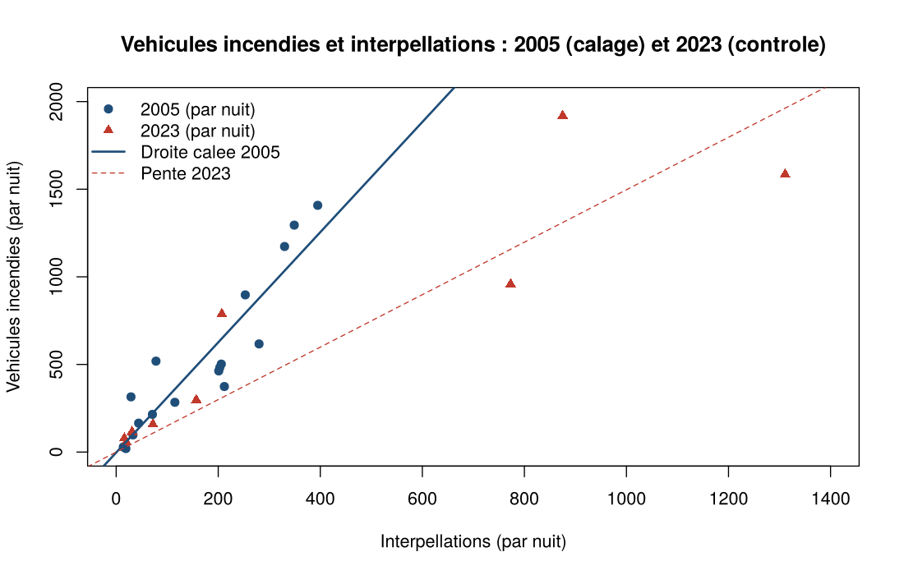
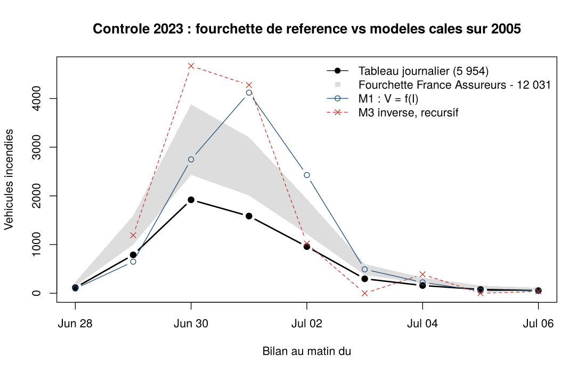
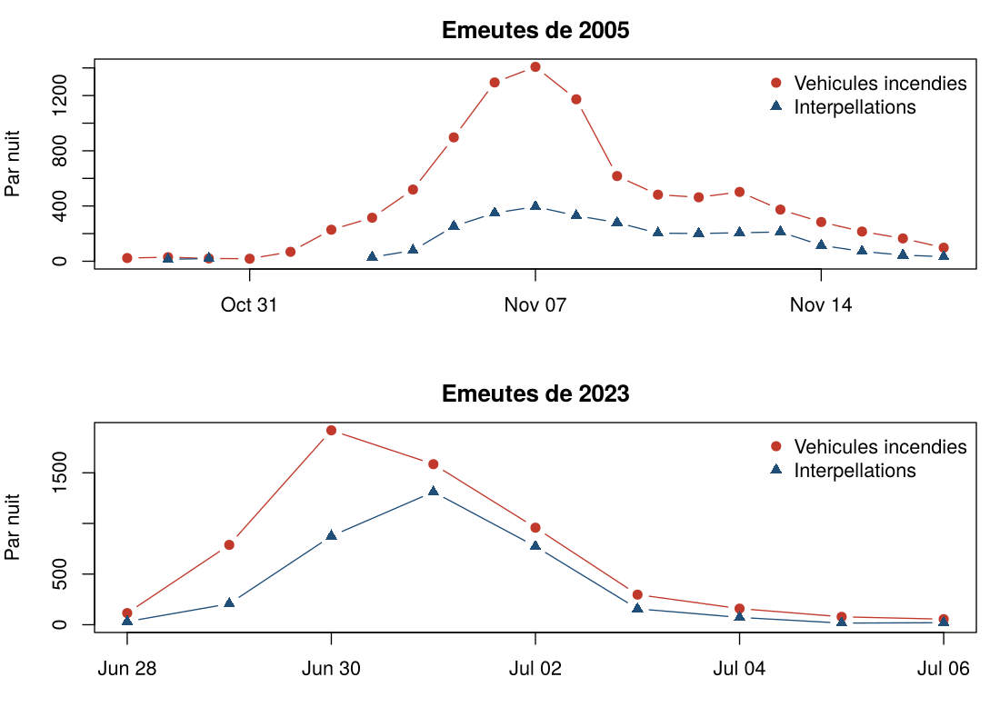

# Émeutes et violences urbaines : un modèle simple des véhicules incendiés

> **Statut** : étude exploratoire. Ordres de grandeur uniquement, pas un outil de tarification.
> **Dernière mise à jour** : AAAA-MM-JJ

<!-- À compléter : deux ou trois phrases d'accroche. Quelle question, quelle réponse, pour qui. -->

## En bref

<!-- À compléter : 3 à 5 lignes. Proposition de trame ci-dessous, chiffres issus du script. -->

- **Question** : peut-on estimer le nombre de véhicules incendiés lors d'un épisode de violences urbaines à partir des interpellations et des effectifs de forces de l'ordre mobilisés ?
- **Méthode** : calage sur les émeutes de 2005 (17 nuits exploitables), contrôle hors échantillon sur celles de 2023 (9 nuits).
- **Résultat** : *à compléter*
- **Réserve principale** : *à compléter*

## Sommaire

- [Contexte](#contexte)
- [Données](#données)
- [Méthode](#méthode)
- [Résultats](#résultats)
- [Limites](#limites)
- [Conclusion](#conclusion)
- [Pistes](#pistes)
- [Reproduire l'étude](#reproduire-létude)
- [Sources](#sources)
- [Licence et citation](#licence-et-citation)

## Contexte

<!-- À compléter : pourquoi ce sujet (actualité, enjeu assurantiel), périmètre retenu, ce que l'étude ne traite pas. -->

| | 2005 | 2023 |
|---|---|---|
| Durée | 21 nuits | 9 nuits |
| Véhicules incendiés | 9 193 (décompte du ministère) | 5 954 à 12 031 selon la source |
| Interpellations | 2 921 | 3 462 |
| Forces de l'ordre au pic | 11 500 | 45 000 |
| Coût assuré | 204 M€ | 793 M€ |

## Données

### Fichiers

| Fichier | Contenu |
|---|---|
| `data/emeutes_journalier.csv` | Bilans nuit par nuit de 2005 et 2023 |
| `METADATA.md` | Dictionnaire des colonnes, sources, incohérences relevées, statut de chaque valeur |

<!-- À compléter : arborescence définitive du dépôt. -->

### Convention

Une ligne correspond au bilan **au matin** du jour indiqué, donc à la nuit précédente.

### Variables principales

| Colonne | Contenu | Nature |
|---|---|---|
| `vehicules_incendies` | Véhicules incendiés dans la nuit | Communiqués du ministère de l'Intérieur |
| `interpellations` | Interpellations dans la nuit | Communiqués du ministère de l'Intérieur |
| `fdo_mobilises` | Policiers et gendarmes mobilisés | 2023 : presse ; 2005 : reconstitution à dire d'expert |
| `fdo_bas`, `fdo_haut` | Fourchette des effectifs | Bornes du dire d'expert |
| `fdo_qualite` | Qualité de la valeur d'effectifs | `observe_national` ou `dire_expert` |
| `vehicules_borne_basse`, `vehicules_borne_haute` | Tableau 2023 redressé sur les deux totaux de référence | Profil conventionnel |

Le détail est dans [`METADATA.md`](METADATA.md).

### Deux points d'attention sur les données

**Véhicules incendiés en 2023.** Trois chiffres coexistent ; l'étude retient une fourchette.

| Référence | Total | Source | Remarque |
|---|---|---|---|
| Tableau journalier | 5 954 | Communiqués quotidiens du ministère | Sert de profil nuit par nuit |
| Borne basse | 7 544 | France Assureurs, 46 % de 16 400 sinistres (rapport du Sénat n° 521) | Sinistres déclarés, hors véhicules non assurés contre l'incendie et hors véhicules de l'État |
| Borne haute | 12 031 | Déclaration du ministre de l'Intérieur, 5 juillet 2023 | Chiffre provisoire, repris mais non étayé ni défini par un rapport |

**Effectifs mobilisés en 2005.** Aucune source ne publie leur dynamique nuit par nuit. La série utilisée est une reconstitution à dire d'expert.

<!-- À compléter : le raisonnement de la reconstitution (phases de l'événement, retard de réaction, sources). Trame : -->

| Soirs | Effectifs retenus | Appui |
|---|---|---|
| 27 octobre au 2 novembre | 400 à 500 | *à compléter* |
| 3 novembre | 1 000 à 1 500 | *à compléter* |
| 4 novembre | 3 000 à 4 000 | *à compléter* |
| 5 novembre | 9 000 | *à compléter* |
| À partir du 6 novembre | 11 500 | Engagement maximal estimé par Alain Bertho, recoupé par les communiqués du ministère (11 200 puis 10 600 mi-novembre) |

## Méthode

<!-- À compléter : justification des choix. -->

| Modèle | Forme | Rôle |
|---|---|---|
| M1 | Linéaire : véhicules ~ interpellations | Référence simple |
| M2 | Linéaire : véhicules ~ interpellations + effectifs | Essai, non retenu |
| M3 | Linéaire à retard : interpellations ~ véhicules de la nuit et de la veille, puis inversion | Test de l'effet retard |
| G1 | Quasi-Poisson, lien log : véhicules ~ log(interpellations) | Modèle de comptage |
| **G2** | **Quasi-Poisson, lien log : véhicules ~ log(interpellations) + log(effectifs)** | **Modèle principal** |

- **Calage** : 17 nuits de 2005 pour lesquelles les interpellations sont publiées.
- **Contrôle** : prévision des 9 nuits de 2023, comparée aux trois références.
- **Contrôle inverse** : calage sur 2023, prévision de 2005.
- **Sensibilité** : G2 recalé avec les bornes basse et haute des effectifs 2005, et avec les points du rapport du Sénat n° 84.

## Résultats

### Total prédit pour 2023, modèles calés sur 2005

| Modèle | Total prédit | Rapport au tableau (5 954) | Rapport à la borne basse (7 544) | Rapport à la borne haute (12 031) |
|---|---|---|---|---|
| M1 | 10 859 | × 1,82 | × 1,44 | × 0,90 |
| M2 | 5 775 | × 0,97 | × 0,77 | × 0,48 |
| G1 | 9 717 | × 1,63 | × 1,29 | × 0,81 |
| **G2** | **7 525** | **× 1,26** | **× 1,00** | **× 0,63** |

<!-- À compléter : commentaire. -->

### Effet des effectifs

| Calage | Élasticité aux effectifs | p |
|---|---|---|
| 2005 | −0,37 | 0,006 |
| 2023 | −0,42 | 0,094 |

<!-- À compléter : interprétation (à interpellations égales, plus d'effectifs va avec moins de véhicules incendiés ; lecture proposée : les effectifs massifs augmentent les interpellations sans réduire les feux dans la même proportion). -->

### Sensibilité à la série d'effectifs 2005

| Série | Élasticité | Total prédit 2023 |
|---|---|---|
| Dire d'expert, valeur centrale | −0,37 | 7 525 |
| Dire d'expert, bornes basses | −0,33 | 7 712 |
| Dire d'expert, bornes hautes | −0,40 | 7 348 |
| Centrale, avec les points du rapport du Sénat n° 84 | −0,38 | 6 773 |

### Figures

<!-- À compléter : chemins définitifs. -->







## Limites

<!-- À compléter et hiérarchiser. Les deux premières sont à conserver telles quelles ou reformulées. -->

1. **Effectifs 2005 reconstitués.** La série a été établie à dire d'expert, après les premiers ajustements. Elle n'a pas été calée sur la cible, mais ce risque de sur-ajustement doit être signalé. Le raisonnement et les sources sont dans `METADATA.md`, et l'analyse de sensibilité en mesure l'effet.
2. **Calendrier de la montée en charge.** Le rapport du Sénat n° 84 (16 novembre 2005) indique 8 000 hommes engagés au 7 novembre, renforcés de 1 500 réservistes. La série retenue atteint 11 500 dès le soir du 6. L'écart porte sur la date du pic, pas sur son niveau : les communiqués ultérieurs donnent 11 200. La variante alignée sur le Sénat abaisse la prévision de 10 %.
3. **Deux événements seulement.** *à compléter*
4. **Contrôle inverse médiocre.** Calé sur 2023 et appliqué à 2005, G2 surestime de 32 %.
5. **Confusion possible avec le calendrier.** Dans les deux épisodes, les effectifs montent pendant que les incendies retombent.
6. **Périmètre des comptages.** *à compléter (véhicules de l'État, zone gendarmerie, niveau habituel d'incendies)*
7. **Profil par nuit des bornes 2023.** Redressement uniforme, conventionnel.
8. **Portée assurantielle.** Les véhicules représentent 46 % des sinistres de 2023 mais 6 % du coût.

## Conclusion

<!-- À compléter. -->

## Pistes

<!-- À compléter. Éléments déjà identifiés : -->

- **Modèle de propagation.** Bonnasse-Gahot et al. (2018) décrivent les émeutes de 2005 comme une contagion : modèle épidémiologique par commune, influence décroissante avec la distance. *à compléter*
- **Indice de dommage composite** (véhicules et bâtiments) plutôt que les seuls véhicules.
- **Niveau habituel d'incendies** à retrancher.
- *à compléter*

## Reproduire l'étude

```bash
Rscript modele_emeutes.R
```

- R de base, aucun package requis. Testé avec R 4.3.3.
- Entrées : `data/emeutes_journalier.csv` et `data/mouvement_2026.csv`.
- Sorties : tableaux et figures dans `sorties/` (seules les figures sont versionnées).

### Arborescence

```
.
├── README.md
├── METADATA.md                 dictionnaire des données, sources, incohérences
├── modele_emeutes.R            calage 2005, contrôle 2023, sensibilité, figures
├── appliquer_scenario.R        application de G2 à un nouvel événement
├── data/
│   ├── emeutes_journalier.csv  bilans nuit par nuit 2005 et 2023
│   └── mouvement_2026.csv      chiffres du mouvement lycéen 2026 (illustration)
└── sorties/                    figures produites par le script
```

## Appliquer le modèle à un nouvel événement

```bash
Rscript appliquer_scenario.R <interpellations> <effectifs_min> <effectifs_max>
```

Le script recale G2 sur 2005, puis prévoit le nombre de véhicules incendiés pour l'effectif minimal, médian et maximal. L'intervalle de prévision à 95 % combine l'incertitude des coefficients et le bruit quasi-Poisson ; c'est une approximation normale, à lire comme un ordre de grandeur.

Exemple : journée de mobilisation du 17 octobre 2026, 1 200 interpellations (bilan du Premier ministre), effectifs supposés de 25 000 à 45 000.

```bash
Rscript appliquer_scenario.R 1200 25000 45000
```

| Effectifs | Véhicules (central) | Intervalle à 95 % |
|---|---|---|
| 25 000 | 3 299 | 1 893 – 4 705 |
| 35 000 | 2 918 | 1 656 – 4 179 |
| 45 000 | 2 662 | 1 475 – 3 849 |

Réserve : le modèle est calé sur des nuits d'émeutes en quartiers. Une journée de manifestation en centre-ville, avec beaucoup d'interpellations préventives, sort de son domaine de validité ; la prévision y est probablement haute.

## Sources

**Données**

- Wikipédia, [Émeutes de 2005 dans les banlieues françaises](https://fr.wikipedia.org/wiki/%C3%89meutes_de_2005_dans_les_banlieues_fran%C3%A7aises), tableau « Vue d'ensemble ».
- Wikipédia, [Émeutes consécutives à la mort de Nahel Merzouk](https://fr.wikipedia.org/wiki/%C3%89meutes_cons%C3%A9cutives_%C3%A0_la_mort_de_Nahel_Merzouk), tableau « Chiffres ».
- Le Parisien, [Les émeutes en chiffres, nuit par nuit](https://www.leparisien.fr/faits-divers/interpellations-voitures-brulees-batiments-degrades-les-emeutes-en-chiffres-nuit-par-nuit-03-07-2023-S7M7QZT5TBC63IC6AAC7XTBETQ.php), 3 juillet 2023.
- France Assureurs, [communiqué du 6 septembre 2023](https://www.franceassureurs.fr/espace-presse/les-communiques-de-presse/cout-sinistres-declares-violences-urbains-fin-juin-reevalue-730millions-euros/).

**Rapports**

- Sénat, [rapport d'information n° 521 (2023-2024)](https://www.senat.fr/rap/r23-521/r23-5211.pdf), *Émeutes de juin 2023 : comprendre, évaluer, réagir*.
- Sénat, [rapport n° 84 (2005-2006)](https://www.senat.fr/rap/l05-084/l05-0843.html), prorogation de l'état d'urgence.
- Sénat, [rapport d'information n° 49 (2006-2007)](https://www.senat.fr/rap/r06-049-1/r06-049-11.pdf), *Un nouveau pacte de solidarité pour les quartiers*.
- Centre d'analyse stratégique, [Enquêtes sur les violences urbaines](https://www.vie-publique.fr/files/rapport/pdf/074000340.pdf), 2006.

**Travaux de recherche**

- A. Bertho, [Émeutes de 2005 dans les banlieues françaises](https://berthoalain.com/wp-content/uploads/2007/12/emeutes-de-2005-dans-les-banlieues-francaises.pdf).
- L. Bonnasse-Gahot, H. Berestycki, M.-A. Depuiset, M. B. Gordon, S. Roché, N. Rodríguez, J.-P. Nadal, « Epidemiological modelling of the 2005 French riots: a spreading wave and the role of contagion », *Scientific Reports*, 2018.

<!-- À compléter : autres sources consultées. -->

## Licence et citation

<!-- À compléter : licence du code, licence des données (les tableaux Wikipédia sont sous CC BY-SA), mention d'auteur, manière de citer. -->
